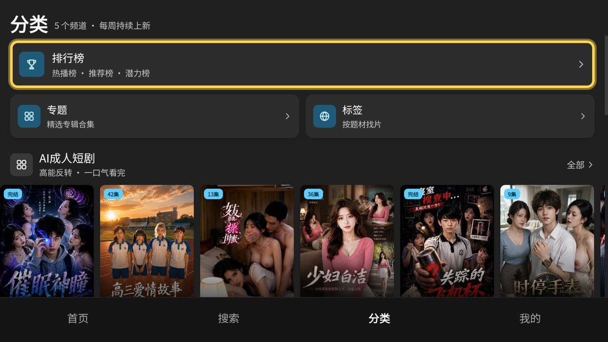
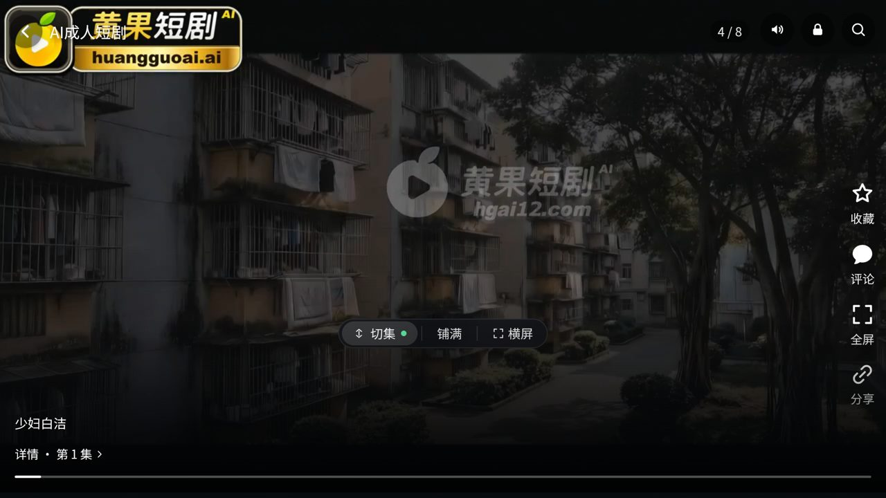

# HGhub TV Patch — 讓 HGhub 在 Android TV / 電視盒上用遙控器操作

把 [HGhub](https://github.com/zxsos/HGhub)（黃果短劇第三方客戶端，Tauri 2 + Rust/React）改成
**遙控器可操作**的電視版：方向鍵移動焦點、OK 進入、返回鍵分層、開機帶聲，
Fire TV 上改用原生 ExoPlayer 播放（繞過 Amazon WebView 有聲無影的解碼缺陷），
並補上**播完自動接下一集**與**跨進入的續播**。

> ⚠️ **這個 repo 只放補丁，不含上游完整原始碼。**
> 上游是 **PolyForm Noncommercial 1.0.0** 授權，本補丁同樣受其約束：**禁止任何商業用途**。
> 與上游作者無關，非官方改造。若上游或權利方要求，會立即下架。

🔗 **完整原始碼（已套用本補丁的電視版）**：<https://github.com/oykhabc-maker/HGhub/tree/tv31>
（分支 `tv31`，基於上游 `2c55dfe`；上游主線已到 1.2.19，尚未 rebase）

| 首頁（分類） | 播放中 |
| --- | --- |
|  |  |

> 上圖為 tv1 版本；tv31 起電視模式**不再顯示上下頁籤列**（切分頁改用遙控器數字鍵 1-4）。

## 內容

```
hghub-tv-tv31.diff     # 18 個檔案的源碼差異（可 git apply，不含 android-tv/）
android-tv/            # 原生覆蓋層：gen/android 被 gitignore，需在 tauri init 後套用
  ├── MainActivity.kt  #   DPAD 橋接、允許帶聲自動播放、HGPlayer/HGEnv JS 介面
  ├── PlayerActivity.kt#   Fire TV 原生播放器（Media3/ExoPlayer）、每秒回報播放位置
  ├── apply.mjs        #   一鍵套用（含 manifest banner、PlayerActivity、Media3 依賴、applicationId）
  ├── network_security_config.xml  # 只放行 127.0.0.1 明文（原生播放器讀 loopback 代理）
  ├── tv_banner.png    #   320×180 Android TV banner
  └── README.md
TV-REMOTE.md           # 改動說明、遙控器操作對照、真機踩到的坑
LICENSE                # PolyForm Noncommercial 1.0.0（含 Required Notice）
```

## 套用

基準 commit：`2c55dfe`（feat(feed): 桌面端切集开关生效…）。上游持續更新，若 `git apply` 有衝突，
用 `git apply -3` 走三方合併，或把 `src/tv/` 與既有檔的改動手動搬過去（改動很集中）。

```bash
git clone https://github.com/zxsos/HGhub.git hghub-tv
cd hghub-tv
git checkout 2c55dfe
git apply /path/to/hghub-tv-tv31.diff
cp -a /path/to/android-tv .

pnpm install
pnpm tauri android init --ci
node android-tv/apply.mjs        # 套原生改動（DPAD 橋接、原生播放器、TV banner、applicationId）

# 交付給電視盒：arm64 + armv7 通用包
pnpm tauri android build --target aarch64 --target armv7 --apk

# 模擬器除錯：x86_64（要驗原生播放器路徑可加 --ez forceNative true 啟動）
pnpm tauri android build --target x86_64 --debug --apk
```

`release` APK 是 **unsigned**，要自己簽：

```bash
zipalign -f 4 app-universal-release-unsigned.apk aligned.apk
apksigner sign --ks ~/.android/debug.keystore --ks-key-alias androiddebugkey \
  --ks-pass pass:android --key-pass pass:android --out HGhub-TV.apk aligned.apk
```

## 做了什麼

1. **焦點引擎** `src/tv/focus.ts`：WebView 不會用方向鍵移動 DOM 焦點，用
   `getBoundingClientRect()` 做幾何最近鄰搜尋；以 capture 掛 `keydown`，處理完
   `preventDefault + stopPropagation`，不跟播放器的按鍵處理打架。
2. **原生 DPAD 橋接** `android-tv/MainActivity.kt`：**這是最關鍵的一項**。部分電視盒
   （實測 Google TV Streamer / Android 14）的 WebView 會把方向鍵當成自己的焦點導航吃掉，
   `keydown` 根本送不到 JS（數字鍵卻正常）。改由 `dispatchKeyEvent` 攔下來呼叫
   `window.__tvKey(code)`，前端再合成一次 keydown，焦點引擎與播放器就都走同一條路。
3. **返回鍵階層**：面板 → 彈窗 → 頁面堆疊 → 回瀏覽頁 → 連按兩次才退出（第一次只提示），
   避免手滑直接掉回桌面。
4. **電視 UI**：字級與卡片放大、單一黃色焦點框（`::after` + inset box-shadow，
   用 `outline` 會被 `overflow:hidden` 的橫向捲動列裁掉）、320×180 TV banner、
   獨立 `applicationId` 以便與官方版並存。tv31 起**上下頁籤列都不畫**，內容滿版。
5. **開機帶聲**：上游 `muteOnStartup` 預設 `true`，這裡改預設不靜音，並用
   `hghub_unmute_v1` 做一次性遷移（舊安裝也會改過來），之後尊重使用者設定；
   另設 `mediaPlaybackRequiresUserGesture = false`，避免 Chromium 把自動播放的影片消音。
6. **Fire TV 原生播放器** `android-tv/PlayerActivity.kt`：Amazon WebView 138 會跟 MediaCodec
   要 6.2 MB 的影像表面，但 AWV 卡在 1 MB（`failed to set min buffer size … 1048576`），
   結果是解碼器有幀、`requestVideoFrameCallback` 在跳、螢幕全黑。改由 ExoPlayer 播同一個
   Rust HLS 代理網址（`http://127.0.0.1:17650/hls?u=…`），鑑權與分片改寫完全不用重做。
7. **播放狀態回傳（tv31）**：原生播放器每秒回報 `__hgNativeTick(pos, dur, playing)`，
   播完先問前端 `__hgNativeEnded()`——有下一集就原地換源、沒有才關播放器。WebView 端
   據此寫觀看記錄、自動續播（`play/load` 帶 `startMs`，等 `STATE_READY` 才 seek），
   電視上原本「進度永遠 0、播完掉回列表、按上下鍵沒反應」三個問題一起修掉。
8. **遙控器切集不受開關影響**：`swipeEp`（上下划切集）原本只管手機手勢，但電視上下鍵
   誤用了同一條判斷，關掉開關時按上下鍵只會在背景列表捲動。tv31 起播放中的上下鍵
   一律先切集，沒有下一集才切上一／下一部劇。
9. **歷史播放（tv31c）**：頁籤列拿掉後「我的 → 觀看歷史」很難到，於是拉成獨立頁
   `src/pages/History.tsx`，入口在分類頁「排行榜」下面。一列一部（封面／第幾集／看到幾分幾秒／進度條），
   點進去直接從上次位置續播，底部可清空（記錄只存本機 localStorage）。
10. **每次進入 App 自動更新（tv31c）**：電視不會重載 WebView，`MainActivity.onResume`
   在「不是從原生播放器回來」時呼叫 `window.__hgAppResume()`，首頁重抓第一頁並重新洗牌、
   分類頻道預覽改抓 24 筆隨機挑 8 筆（伺服器第一頁固定不動）。正在播時跳過，不打斷播放。
   順手修掉「電視一開機就自動跳進某一部劇」：看不見的頁面（`active=false`）不准開原生播放器，
   而且電視的預設分頁在 store 初始化時就決定為「分類」。

## 遙控器操作

| 按鍵 | 作用 |
| --- | --- |
| ↑ ↓ ← → | 移動焦點（幾何最近鄰，含捲動） |
| OK | 進入 / 播放暫停 |
| 播放中 ↑ ↓ | 切上一集／下一集（原生活播放器裡一律切集） |
| 播放中 ← → | −15 秒／+15 秒（ExoPlayer 預設 seek 量） |
| 返回 | 上一層；根頁連按兩下退出 |
| 1 / 2 / 3 / 4 | 首頁 / 搜索 / 分類 / 我的（電視模式沒有頁籤列，靠這組鍵） |

分類頁由上而下：排行榜 → **歷史播放** → 專題／標籤 → 各頻道預覽 → 黃果吃瓜。

## 驗證環境

| 裝置 | 系統 | 結果 |
| --- | --- | --- |
| Fire TV Stick 4K Max (`AFTKA`) | Fire OS 9（armeabi-v7a） | tv31c 實測：開機停在分類不自動播、歷史播放 36 筆續播 `start=14.0s`、回前景 `[refresh]` 重抓、上下鍵切集、播完自動接下一集 |
| Google TV Streamer | Android 14（32-bit userspace, armeabi-v7a） | 導覽／播放／切集／返回／帶聲全部實測通過（WebView 播放器路徑） |
| Android TV 36 模擬器 | x86_64, 1920×1080 | 開發期逐項驗證（`--ez forceNative true` 可強制走原生播放器路徑） |

除錯日誌：`adb logcat -s HGTV`，可看到 `[tv] focus x= y= w= h=`、`[play] native url=… start=`
（`start` 就是續播起點）、`[ep] native step/ended`。

## 已知限制

- 搜索頁打字仍需輸入法；遙控器可用「熱門題材」或搜尋歷史代替。
- 播放器的詳情／評論／選集面板尚無遙控器入口（上下鍵已能切集）。
- 電視模式沒有頁籤列，只能靠數字鍵 1-4 切分頁。

## 授權

本補丁是 HGhub 的衍生作品，依 **PolyForm Noncommercial License 1.0.0** 釋出（見 [LICENSE](LICENSE)）。

Required Notice: Copyright (c) 2026 HGhub contributors (https://github.com/Minireel/HGhub)

- 你可以：非商業地使用、修改、散布（需保留本授權與 Required Notice、標明修改）。
- 你不能：任何商業用途（販售、廣告／會員變現、作為收費服務的一部分）。
- 請勿把接口位址、播放直鏈、解密方式公開張貼或打包成「資源站」——上游一旦封禁，所有人都沒得用。
